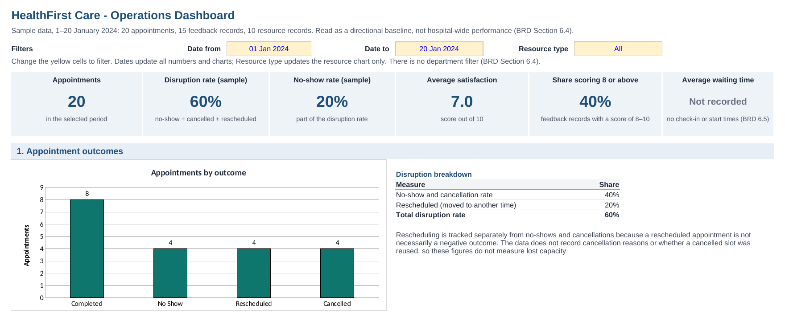

# HealthFirst Care – Enhancing Operational Efficiency in a Multi-Specialty Hospital

**Business Analysis case study** · BRD · RTM · Stakeholder Analysis · Process Models (BPMN) · Data Analysis · Risk Management

HealthFirst Care is a multi-specialty hospital with five clinical departments, supported by administrative, nursing and IT functions. This case study looks at how the hospital could improve appointment management, resource visibility, patient communication and coordination across departments.

> **Note:** This is a Business Analysis case study. Stakeholder input comes from simulated stakeholder profiles and a case brief, not from live interviews. The data is a small sample, so the findings are directional. System selection, development and implementation are outside the scope.

## Key numbers

| Pain points | Requirements | Process models | Stakeholder groups | Risks | Slides |
|:---:|:---:|:---:|:---:|:---:|:---:|
| **10** | **26** (7 business, 15 functional, 4 non-functional) | **6** (3 processes, As-Is and To-Be, in BPMN) | **6** | **6** | **19** |

## Business problem

Appointment scheduling, patient information management and operational reporting rely on separate systems and manual processes. An online appointment channel exists, but the operating model still depends heavily on staff assistance and manual coordination. This limits visibility across departments and makes it difficult to coordinate appointments, communicate changes promptly and allocate available resources.

## Key findings

| Finding | Evidence |
|---|---|
| **60%** of sampled appointments (12 of 20) did not go ahead as originally scheduled: **40%** were recorded as No Show or Cancelled (no-show rate **20%**), and **20%** were rescheduled. | Appointment data, 20 records |
| Average patient satisfaction is **7.0 / 10**, and **40%** of feedback records score 8 or above. | Feedback data, 15 records |
| Patients report waits of more than 30 minutes past the appointment time, and nearly an hour in one case. No dataset records check-in or consultation start time, so a waiting-time baseline cannot be calculated. | Patient profiles; measurement gap |
| Resource visibility is limited, information passes between departments through manual hand-offs, and operational reports are prepared manually. | Case brief and simulated stakeholder profiles |



*Top of the operations dashboard. The full dashboard, with satisfaction and resource charts, is on the [Data Analysis](docs/06-data-analysis.md#dashboard) page.*

## BA approach

Business problem → Evidence → Current state → Root-cause analysis → Business needs → Requirements → Future state → Validation approach

Each requirement traces back to a pain point, and the RTM records its evidence type: data, elicitation, case brief or constraint. The root-cause analysis looks at three problem areas separately, because the available evidence does not establish a single causal chain: appointment disruption, interdepartmental coordination and patient waiting time.


*To-Be appointment scheduling process in BPMN ([Process Analysis §1.2](docs/05-process-analysis.md#12-to-be-appointment-scheduling))*

## Documents

All documents can be read directly on GitHub. Suggested order:

| # | Document | Content |
|---|---|---|
| 00 | [Project Summary](docs/00-project-summary.md) | The case study in 19 slides |
| 01 | [Project Overview](docs/01-project-overview.md) | Context, approach, scope and document list |
| 02 | [BRD](docs/02-brd.md) | Business problem, findings, root cause, objectives, requirements, limitations and acceptance criteria |
| 03 | [RTM](docs/03-rtm.md) | Requirement source, evidence, related data, priority and verification |
| 04 | [Stakeholder Analysis & Engagement Plan](docs/04-stakeholder-analysis.md) | Stakeholder profiles, influence / interest matrix and engagement plan |
| 05 | [Process Analysis](docs/05-process-analysis.md) | As-Is and To-Be BPMN models, gap analysis and user stories |
| 06 | [Data Analysis](docs/06-data-analysis.md) | Cleaned data, baseline indicators, analysis tables and the dashboard |
| 07 | [Risk Management Plan](docs/07-risk-management-plan.md) | Risk register, risk matrix, mitigation and contingency plans |
| – | [Data](data) | The three sample datasets (CSV) |

Short on time? Read the [Project Summary](docs/00-project-summary.md) first, then the [BRD](docs/02-brd.md).

## Traceability example

One trace from the [RTM](docs/03-rtm.md):

| Pain point | Business requirement | Functional requirement | Verification |
|---|---|---|---|
| [PP-10](docs/02-brd.md#4-current-state-analysis): patients report waiting more than 30 minutes, and nearly an hour in one case, without updates during the delay. | [BR-07](docs/03-rtm.md#br-07): measure and reduce the time patients wait between check-in and the start of their consultation. | [FR-16](docs/03-rtm.md#fr-16): record the check-in time and the consultation start time for each attended appointment (waiting time = consultation start time − check-in time). | Check that both times are recorded for each attended appointment, calculate waiting time, and confirm the average can be produced for a defined reporting period. |

This builds the waiting-time baseline that the case brief's 20% reduction target needs.

## What this case study covers

| BA work | Where |
|---|---|
| Business problem and background | [BRD §1–2](docs/02-brd.md#1-project-overview) |
| Stakeholder identification, influence / interest and engagement | [Stakeholder Analysis](docs/04-stakeholder-analysis.md) |
| Current-state pain points | [BRD §4](docs/02-brd.md#4-current-state-analysis) |
| Root-cause analysis (three branches) | [BRD §5](docs/02-brd.md#5-root-cause-analysis) |
| Data analysis, limitations and measurement gaps | [BRD §6](docs/02-brd.md#6-data-analysis-summary), [Data Analysis](docs/06-data-analysis.md) |
| Objectives, proposed acceptance criteria and baseline indicators | [BRD §7](docs/02-brd.md#7-business-objectives-and-baseline-indicators) |
| Scope | [BRD §8](docs/02-brd.md#8-scope) |
| Business, functional and non-functional requirements | [BRD §9](docs/02-brd.md#9-requirements) |
| Assumptions, constraints and dependencies | [BRD §10](docs/02-brd.md#10-assumptions-constraints-and-dependencies) |
| MoSCoW prioritisation and traceability | [RTM](docs/03-rtm.md) |
| As-Is / To-Be process models and gap analysis | [Process Analysis](docs/05-process-analysis.md) |
| User stories with acceptance criteria (Given/When/Then) | [Process Analysis §4](docs/05-process-analysis.md#4-user-stories-and-acceptance-criteria) |
| Dashboard | [Data Analysis](docs/06-data-analysis.md#dashboard) |
| Risk register, matrix and contingency plans | [Risk Management Plan](docs/07-risk-management-plan.md) |

## Repository structure

```
.
├── README.md                  Project overview (this page)
├── docs/                      Documents in Markdown, readable on GitHub
│   ├── 00-project-summary.md
│   ├── 01-project-overview.md
│   ├── 02-brd.md
│   ├── 03-rtm.md
│   ├── 04-stakeholder-analysis.md
│   ├── 05-process-analysis.md
│   ├── 06-data-analysis.md
│   └── 07-risk-management-plan.md
├── assets/
│   ├── diagrams/              As-Is and To-Be BPMN process models
│   ├── dashboard/             Operations dashboard (full and top section)
│   └── slides/                Slide images for the Project Summary
└── data/                      Sample datasets (CSV) and data notes
```

## Limitations

- Stakeholder input comes from simulated stakeholder profiles and a case brief, not live interviews. Hospital Management has no profile, so its concerns are taken from the case brief.
- The data is a sample of 20 appointment, 15 feedback and 10 resource records. Findings are directional and need validation against current operational data.
- Waiting time and double bookings cannot be measured with the available data. The case brief sets one target, a 20% reduction in average waiting time, which cannot be assessed until a baseline exists.
- The discharge scenario used for interdepartmental coordination is illustrative; its steps are a modelling assumption that has not been validated.
- All requirements are at *Proposed* status, and the acceptance criteria have not been validated with stakeholders or tested in a live system.
