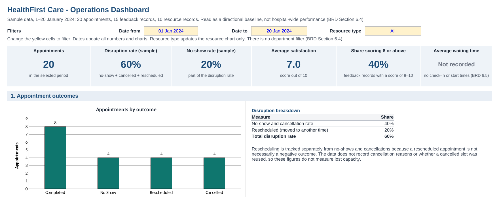
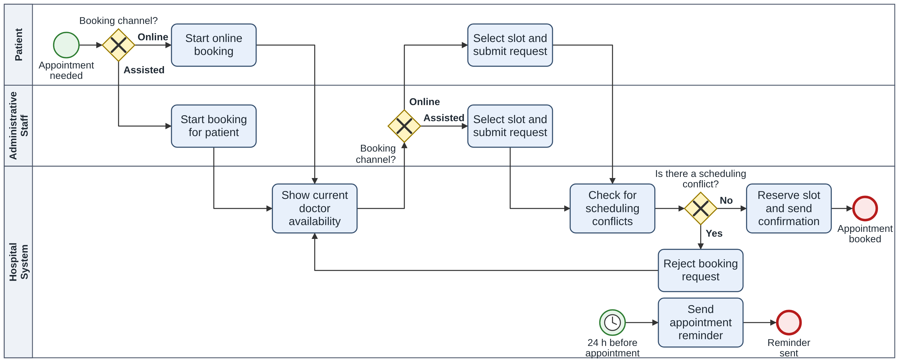

# HealthFirst Care — Hospital Operations Improvement

A Business Analysis capstone case study on where appointments, resources and information break down in a multi-specialty hospital, and what the hospital needs to fix them.

**Role:** Business Analyst · **Type:** Capstone project · **Timeline:** May – Jul 2026 · **Domain:** Healthcare operations

> [!NOTE]
> This is a course capstone, not work for a real hospital. It uses a case brief, simulated stakeholder profiles and three small sample datasets. No live interviews were held, no system was selected or built, and the requirements have not been validated or tested.

## At a glance

|  |  |
|---|---|
| **Problem** | Scheduling, patient records and reporting run on separate systems and manual work. Patients face disrupted appointments and long waits; staff cannot see current doctor, room or equipment availability. |
| **Approach** | Data analysis in Excel, root cause analysis by problem area, As-Is / To-Be modeling in BPMN, gap analysis, stakeholder analysis |
| **Proposed improvements** | Online booking with conflict checks, reminders and delay notices, live room and equipment status, shared patient information between departments, and recording check-in and consultation start times |
| **Key evidence** | 60% appointment disruption, 20% no-show, satisfaction 7.0 / 10 (sample data) |
| **Deliverables** | BRD, RTM (26 requirements), stakeholder analysis, 6 BPMN models, data analysis with dashboard, risk management plan, 19-slide summary |

**Start here:** the [Project Summary](docs/01-project-summary.md) (19 slides), then the [BRD](docs/02-brd.md).

## Deliverables

| # | Document | What it shows |
|---|---|---|
| 00 | [Project Overview](docs/00-project-overview.md) | Context, approach and document list |
| 01 | [Project Summary](docs/01-project-summary.md) | The case study in 19 slides |
| 02 | [BRD](docs/02-brd.md) | Pain points, root cause, data findings and limits, objectives, scope and requirements |
| 03 | [RTM](docs/03-rtm.md) | Source, evidence, priority and verification for each requirement |
| 04 | [Stakeholder Analysis](docs/04-stakeholder-analysis.md) | Stakeholder profiles, influence / interest matrix and engagement plan |
| 05 | [Process Analysis](docs/05-process-analysis.md) | As-Is and To-Be BPMN models, gap analysis and user stories |
| 06 | [Data Analysis](docs/06-data-analysis.md) | Cleaned data, baseline indicators, analysis tables and the dashboard |
| 07 | [Risk Management Plan](docs/07-risk-management-plan.md) | Risk register, risk matrix, mitigation and contingency plans |
| – | [`data/`](data) | Sample datasets (CSV) and data notes |

## 1. Context and problem

The hospital has five clinical departments, supported by administrative, nursing and IT teams. Scheduling, patient records and operational reporting run on separate systems and manual work:

- An online booking channel exists, but it is hard to use and affected by network downtime, so many patients still book by phone or in person.
- Staff cannot always see current doctor, room or equipment availability.
- Information moves between departments through manual hand-offs.
- Reports are prepared by hand.

The BRD lists 10 pain points ([BRD §4](docs/02-brd.md#4-current-state-analysis)).

**Objectives** ([BRD §7.1](docs/02-brd.md#71-objectives-and-proposed-acceptance-criteria)):

1. Reduce patient waiting time (the case brief sets a 20% reduction target).
2. Reduce no-shows and cancellations, and report rescheduling separately.
3. Make booking and changing appointments easier, and keep patients informed.
4. Show current resource availability, and share information across departments without re-entry.
5. Give management a current view of appointment outcomes without manual reports.

System selection, development and implementation are out of scope ([BRD §8](docs/02-brd.md#8-scope)).

## 2. My role and approach

This was my capstone project. Working from the case brief and the stakeholder profiles, I:

1. **Analyzed the data.** Cleaned and linked three sample datasets in Excel, calculated baseline indicators and built a dashboard.
2. **Found the problems.** Identified pain points and analyzed root causes in three separate problem areas.
3. **Modeled the processes.** Mapped three processes As-Is and To-Be in BPMN and wrote the gap analysis.
4. **Specified.** Wrote business, functional and non-functional requirements, user stories, and traced them in an RTM.
5. **Planned for delivery.** Prepared the stakeholder analysis and engagement plan, the risk management plan and the summary slides.

## 3. Key findings

The three sample datasets cover 1–20 January 2024 (20 appointments, 15 feedback records, 10 resource records). The sample is small, so every figure is a directional baseline, not hospital-wide performance.

| Indicator | Sample result | How it is calculated |
|---|---|---|
| Appointment disruption | **60%** (12 of 20) | (No Show + Cancelled + Rescheduled) ÷ all appointments |
| No-show rate | **20%** (4 of 20) | No Show ÷ all appointments |
| No-show and cancellation rate | **40%** (8 of 20) | (No Show + Cancelled) ÷ all appointments |
| Average satisfaction | **7.0 / 10** | Mean of 15 feedback scores; 6 of 15 score 8 or above |
| Average waiting time | Not measurable | No check-in or consultation start times are recorded |

- Rescheduling is not always negative, so disruption is reported next to the no-show rate.
- The data does not record why appointments were missed, cancelled or rescheduled.
- Patient profiles describe waits of more than 30 minutes, but waiting time cannot be measured from the data.

[](docs/06-data-analysis.md#dashboard)

*Top of the Excel operations dashboard. The full dashboard and analysis tables are on the [Data Analysis](docs/06-data-analysis.md) page.*

**Root causes** ([BRD §5](docs/02-brd.md#5-root-cause-analysis)), analyzed separately for each problem area:

| Problem area | Underlying gap |
|---|---|
| Appointment disruption | The process does not consistently support conflict checks, reminders, easy appointment changes and timely notices |
| Interdepartmental coordination | Information is not available to the next department when needed, because systems are not integrated and hand-offs are manual |
| Patient waiting time | Scheduling and resource assignment lack current availability information, and there is no timestamp to measure the wait |

## 4. Proposed improvements and key decisions

[](assets/diagrams/to-be-appointment-scheduling.png)

*To-Be appointment scheduling ([Process Analysis §1.2](docs/05-process-analysis.md#12-to-be-appointment-scheduling)). All six BPMN models are on the [Process Analysis](docs/05-process-analysis.md) page.*

| To-Be change | Requirements |
|---|---|
| Online booking, rescheduling and cancellation, with an assisted channel that uses the same rules | FR-01, FR-02, FR-05 |
| Current doctor availability at booking, and a conflict check on every new or changed appointment | FR-03, FR-04 |
| Confirmation, reminder and notice of hospital-side changes or delays | FR-07, FR-08, FR-09 |
| Current room and equipment status before assignment | FR-10, FR-11 |
| Check-in time and consultation start time recorded for each attended appointment | FR-16 |
| Patient information available to the next authorized department without re-entry | FR-12, FR-13 |
| A current summary of appointment outcomes for management | FR-14 |

| Decision | Why | Alternative rejected |
|---|---|---|
| Analyze root causes by problem area | The evidence does not support one causal chain | One causal chain for all problems |
| Add FR-16 to record check-in and consultation start times | Waiting time cannot be measured today, so the 20% target cannot be tested without a baseline | Accepting the 20% target as a requirement without a way to measure it |
| Define business needs only, not choose a system | System selection is out of scope; the IT Manager's ideas (HIS, cloud booking) are recorded as options | Recommending a specific system |
| Use discharge as an illustrative scenario | Shows the coordination gap; its steps are a modeling assumption | Presenting the discharge steps as validated |

## 5. Requirements and traceability

There are 26 requirements: 7 business, 15 functional and 4 non-functional (19 Must Have, 7 Should Have). The [RTM](docs/03-rtm.md) records the source, evidence type, MoSCoW priority with a reason, and a verification method for each one. FR-15 was withdrawn and its ID is not reused.

Example trace:

| Pain point | Business requirement | Functional requirement | Verification |
|---|---|---|---|
| [PP-10](docs/02-brd.md#4-current-state-analysis): patients wait more than 30 minutes without updates | [BR-07](docs/03-rtm.md#br-07): measure and reduce the time between check-in and consultation start | [FR-16](docs/03-rtm.md#fr-16): record check-in and consultation start times | Check both times are recorded, calculate waiting time, and confirm the average can be reported for a set period |

## 6. How success would be measured

- **Waiting time:** the 20% target can only be assessed after FR-16 provides a baseline, and the metric definition must be confirmed with Hospital Management.
- **No-shows and cancellations:** track both rates against a validated operational baseline before setting targets.
- **Other objectives:** proposed acceptance criteria are checked through scenario-based UAT ([BRD §7](docs/02-brd.md#7-business-objectives-and-baseline-indicators)).

The [Risk Management Plan](docs/07-risk-management-plan.md) lists six risks, for example staff not adopting the new workflows and requirements built on a small sample not reflecting real operations.

## 7. Assumptions and limitations

- Stakeholder input comes from simulated profiles and a case brief, not live interviews. Hospital Management has no profile, so its concerns come from the case brief.
- The sample is small (20, 15 and 10 records). Findings must be checked against real operational data before targets are set.
- Each department has one doctor, one time slot and the same outcome for all four of its appointments, so department comparisons only reflect how the sample was built.
- Waiting time and double bookings cannot be measured with the available data.
- All requirements are proposed; none has been validated with stakeholders or tested in a live system.

## Repository structure

```
.
├── README.md
├── docs/            Documents in Markdown (00–07), readable on GitHub
├── assets/
│   ├── diagrams/    As-Is and To-Be BPMN process models
│   ├── dashboard/   Operations dashboard (full and top section)
│   └── slides/      Slide images for the Project Summary
└── data/            Sample datasets (CSV) and data notes
```

To check the figures, open the CSV files in [`data/`](data) (GitHub shows them as tables) and compare them with the formulas on the [Data Analysis](docs/06-data-analysis.md) page.

## Tools and techniques

- **Tools:** Excel (data cleaning, analysis and dashboard), BPMN modeling, Word, PowerPoint
- **Techniques:** pain-point analysis, root cause analysis by problem area, As-Is / To-Be modeling, gap analysis, stakeholder influence / interest analysis, MoSCoW, requirements traceability, user stories with Given / When / Then acceptance criteria, risk register and risk matrix
