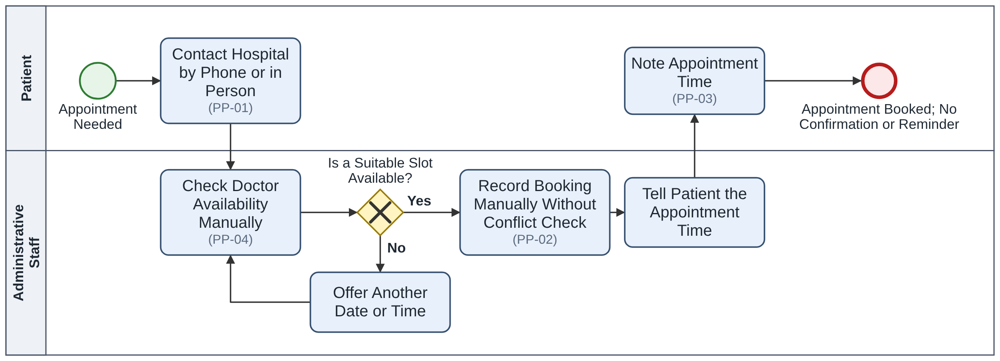
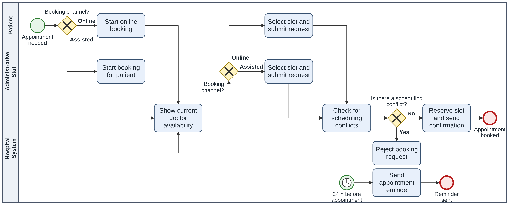
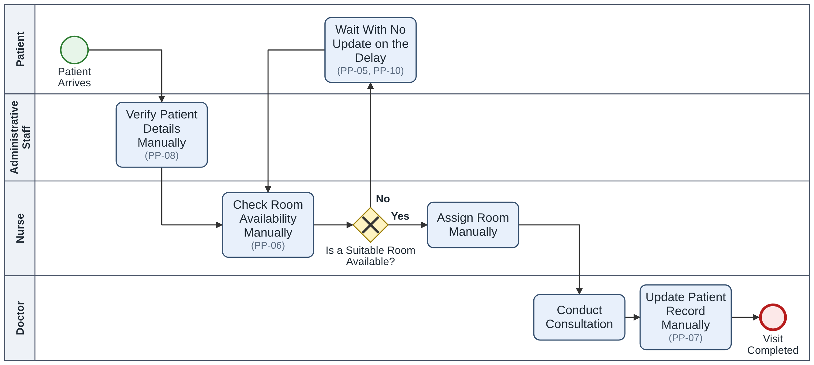
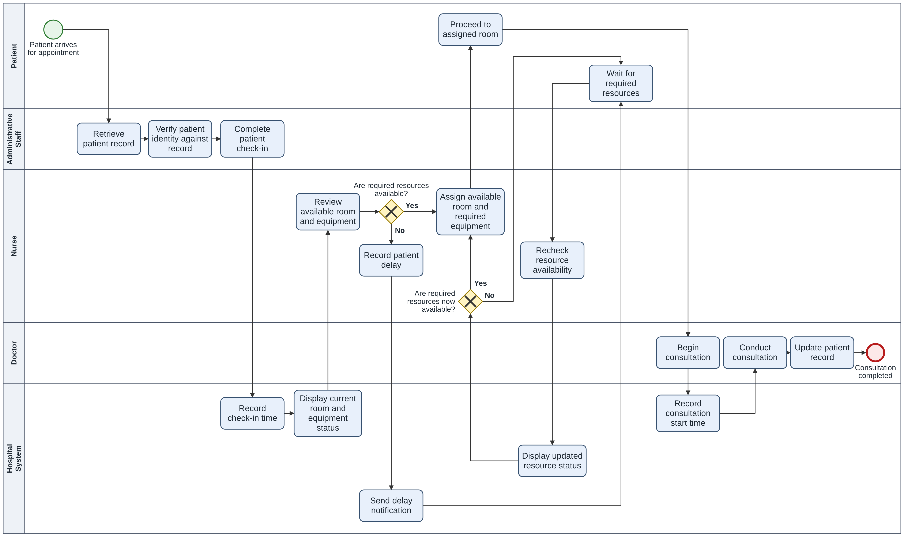
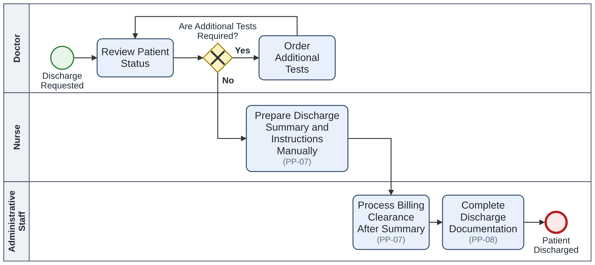
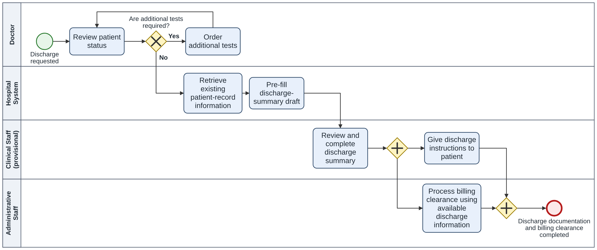

# Process Analysis

*HealthFirst Care - As-Is / To-Be Process Models, Gap Analysis and User Stories*

[← Stakeholder Analysis](04-stakeholder-analysis.md) · [README](../README.md) · [Data Analysis →](06-data-analysis.md)

---

## 1. Appointment Scheduling Process

The current process relies on staff-assisted booking and manual availability checks. The proposed process introduces online self-service, consistent conflict checking, and timely patient communication.

### 1.1 As-Is: Appointment Scheduling Process

*Figure 1.1: As-Is Appointment Scheduling Process Model (BPMN)*

An online booking system exists, but usability issues and network downtime lead many patients to book by phone or in person. Staff check doctor availability manually and record bookings without a reliable conflict check. If no suitable slot is available, staff offer another date or time and check again; this step is a process assumption, as the case materials do not describe it. Patients receive the appointment time but no confirmation or reminder.

**Pain points evidenced:**

- PP-01: The online booking channel is difficult to use and unreliable, so patients often rely on phone or in-person booking. (Patient and IT profiles)

- PP-02: Double bookings occur because bookings are not consistently checked for conflicts. (Administrative Staff profile)

- PP-03: Patients may not receive timely notice of cancellations or delays; the current process lacks confirmation and reminder steps. (Patient profiles and case brief)

- PP-04: Administrative staff have limited visibility of current doctor availability when booking. (Administrative Staff profile)

### 1.2 To-Be: Appointment Scheduling

*Figure 1.2: To-Be Appointment Scheduling Process Model (BPMN)*

Patients can start a booking online or ask administrative staff to book on their behalf. In both channels, the Hospital System shows current doctor availability before a slot is selected, and every submitted request goes through the same conflict check. A conflicting request is rejected; whoever is booking (the patient or staff) then sees the updated availability and selects another slot. Offering up to three alternative slots is a proposal that needs stakeholder confirmation.

The slot is reserved and a confirmation is sent only after the request passes the conflict check. The reminder is a separate, time-triggered step (proposed lead time: 24 hours before the appointment), not part of the booking transaction, and it is sent only for active, confirmed appointments. Rescheduling follows the same availability and conflict-check steps, and a cancelled or rescheduled slot becomes available for booking again.

When authorised staff record a hospital-initiated appointment change, cancellation, or delay, the patient is notified. Rescheduling and cancellation details are covered in the gap analysis and user stories rather than separate process diagrams.

The Hospital System lane shows where system support is required; it does not represent a selected product or vendor. Conflict checking prevents double booking only. It does not set how many appointments a consultation session can hold, which remains an open question (BRD Section 6.5).

**Exception Handling**

| Exception | To-Be handling |
|---|---|
| Notification delivery fails | The booking remains confirmed. The failure is recorded and visible to staff, who contact the patient through the assisted channel. |
| Online booking is unavailable | Patients can use the assisted channel, with the same availability view and conflict check. The fallback process during a complete scheduling-system outage remains to be confirmed. |

### 1.3 Gap analysis

| As-Is step | Pain point | To-Be change | Req. ID |
|---|---|---|---|
| Staff check doctor availability manually | PP-04: Current availability is not readily visible. | Display current doctor availability at the point of booking. | FR-03 |
| Staff record bookings without a reliable conflict check | PP-02: Double bookings occur | Check new and rescheduled appointments against existing appointments and reject conflicts | FR-04 |
| Patients rely on phone or in-person booking when online booking is difficult or unreliable | PP-01: Self-service is difficult to use. | Provide online booking and an assisted channel using the same booking rules. | FR-01, FR-02, NFR-04 |
| No confirmation or reminder; changes and delays may not be communicated promptly | PP-03: Patients are not kept informed. | Confirm successfully processed appointment requests, send reminders, and notify patients of staff-recorded changes or delays. | FR-07, FR-08, FR-09 |
| Rescheduling or cancellation requires phone or in-person contact | PP-01: Changing an appointment is inconvenient. | Allow digital rescheduling and cancellation, and release the original slot for reuse. | FR-05, FR-06 |

## 2. Patient Check-In and Resource Allocation Process

This process addresses limited room and equipment visibility during assignment and contributes to the waiting-time objective. It covers examination rooms and equipment used for outpatient consultations; operating rooms and emergency beds belong to other workflows and are outside this process.

### 2.1 As-Is: Patient Check-In Process

*Figure 2.1: As-Is Patient Check-In Process Model (BPMN)*

Administrative staff verify patient details manually. Nurses then try to assign an examination room without a current view of availability; if no room is available, the patient waits until one becomes free, without updates. After the consultation, the doctor updates the patient record manually.

**Pain points evidenced:**

- PP-05: Patients wait in a manual queue when no examination room is available. (As-Is process and case brief)

- PP-06: Room and equipment status is not consistently visible before assignment. (Cardiology doctor profile; As-Is process)

- PP-10: Patients report long waits without timely updates. (Patient profiles; 2 of 15 feedback comments mention waiting or delay)

- PP-08: Patient details are checked manually because scheduling and patient-record information is held in separate systems. (IT and Administrative Staff profiles)

- PP-07: The patient record is updated manually after the consultation, so information may not reach the next department promptly. (Doctor and nurse profiles)

The available resource data is too limited to establish actual capacity or quantify peak-time shortages.

### 2.2 To-Be: Patient Check-In and Resource Allocation

*Figure 2.2: To-Be Patient Check-In & Resource Allocation Process Model (BPMN)*

Administrative staff retrieve the patient record, verify the patient's identity against it and complete check-in; the Hospital System then records the check-in time. The system displays current room and equipment status, which the nurse reviews. If the required room and equipment are available, the nurse assigns them; resources marked In Use or Under Maintenance cannot be assigned. If they are not available, the nurse records the delay, the system sends a delay notification (FR-09), and the patient waits. The nurse then rechecks availability using the updated status until the required resources are free; the initial notification is not repeated at each recheck. This improves visibility and communication but does not create physical capacity or resolve staffing shortages, which are outside scope.

Once the patient is in the assigned room, the doctor begins the consultation and the system records the consultation start time at that point. Waiting time = consultation start time − check-in time (FR-16). The 20% target and this working definition still need confirmation against the case brief (BRD Section 6.5). After the consultation, the doctor updates the patient record, and the update is available to the next authorised department (FR-12, FR-13).

### 2.3 Gap analysis

| As-Is step | Pain point | To-Be change | Req. ID |
|---|---|---|---|
| Administrative staff verify patient details manually | PP-08: Patient information is held in separate systems and checked manually. | Retrieve the patient record, verify identity against it and complete check-in; the system then records the check-in time. | FR-12, FR-16 |
| Nurse attempts room assignment without current status information | PP-06: Availability is unknown until assignment is attempted. | Display current room and equipment status before assignment; prevent assignment of unavailable resources. | FR-10, FR-11 |
| Patient waits until a room becomes available | PP-05: Manual waiting causes delays. | Nurse records the delay and the system sends a delay notification; the nurse rechecks resource status until the required resources are available. | FR-09, FR-10, FR-11 |
| Patient waits without an update; waiting time is not measured | PP-10: Delays are not adequately communicated or measured. | Notify the patient after staff record a delay; record the check-in time after check-in and the consultation start time when the consultation begins. | FR-09, FR-16 |
| Doctor updates the patient record manually after the consultation | PP-07: Information recorded manually may not reach the next department promptly. | Doctor updates the patient record once; the update is available to the next authorised department without re-entry. | FR-12, FR-13 |

## 3. Interdepartmental Coordination Process

Discharge is used as an illustrative scenario to show coordination between doctors, nurses and administrative staff. The stakeholder profiles describe manual hand-offs in other workflows (test results, referrals and patient transfers) but do not describe discharge, so the As-Is steps below are a modelling assumption that needs validation with clinical and administrative staff. Billing is shown only as a downstream recipient of recorded information; detailed billing and clinical workflows are outside scope.

### 3.1 As-Is: Interdepartmental Coordination Process

*Figure 3.1: As-Is Discharge and Interdepartmental Coordination Process Model (BPMN) – illustrative scenario*

In this scenario, the discharge summary and instructions are prepared manually (shown as a nurse task; the actual role split is not confirmed), and information is passed between departments in sequence. Billing clearance may be delayed while staff wait for the discharge information. Patient feedback is not shown in this flow, and the order of billing clearance and discharge documentation is also an assumption.

**Pain points evidenced**

- PP-07: Information is passed between departments through manual hand-offs, causing delays. (Doctor and nurse profiles report this for test results, referrals and transfers; the discharge steps are assumed.)

- PP-08: Separate systems require information to be re-entered or reconciled. (IT and Administrative Staff profiles).

### 3.2 To-Be: Interdepartmental Coordination

*Figure 3.2: To-Be Discharge and Interdepartmental Coordination Process Model (BPMN) – illustrative scenario*

The Hospital System retrieves existing patient-record information and pre-fills a discharge-summary draft. Clinical staff review and complete the summary; this lane is provisional because the responsible role and approval owner are not confirmed, and the system does not approve the document. Once the summary is complete, discharge instructions (role also to be confirmed) and billing clearance proceed in parallel. Administrative staff process billing clearance using the available discharge information (FR-12, FR-13), and the scenario ends when the discharge documentation and billing clearance are complete.

Patient feedback is not modelled in either discharge diagram: the case materials do not establish it as part of this process or as a dependency for discharge completion. Linking feedback to a specific visit remains a data need rather than a confirmed process requirement.

**Open questions (illustrative scenario, not validated)**

- Does the original case brief include this discharge process?

- Who prepares and completes the discharge summary?

- Who reviews or approves it?

- Which discharge information must be available to administrative staff?

### 3.3 Gap analysis

| As-Is step | Pain point | To-Be change | Req. ID |
|---|---|---|---|
| Nurse prepares the discharge summary manually | PP-07: Manual preparation takes staff time and may delay the next step. | System pre-fills a draft from existing patient-record information; clinical staff (role to be confirmed) review and complete it. | FR-13 |
| Billing waits for the discharge information | PP-07: Manual hand-offs delay downstream processing. | Allow billing clearance and discharge instructions to proceed in parallel once the summary is complete. | FR-12, FR-13 |
| Information is re-entered in separate documentation steps | PP-08: Repeated entry increases effort and the risk of inconsistent records. | Make previously recorded information available to the next authorised department without repeated manual entry. | FR-12, FR-13 |

## 4. User Stories and Acceptance Criteria

The following user stories cover key requirements identified through process analysis. Acceptance criteria use Given/When/Then format to support future verification.

**Scope note:** Screen design and detailed data design are outside the scope of this case study. Proposed thresholds (24-hour reminders, five-minute notifications, 60-second status refreshes and three alternative slots) require stakeholder confirmation.

### US-01: Patient | FR-01, FR-02, FR-03, FR-07

**User Story**

As a patient, I want to book an appointment online or through the front desk, so that I can access the booking service through a suitable channel.

**Acceptance Criteria**

- **AC1:** Given I select a department and date, when available slots are displayed, then only bookable slots with current doctor availability are shown.

- **AC2:** Given I select an available slot, when my booking is successfully processed, then the appointment is confirmed and a confirmation is sent.

- **AC3:** Given I cannot use online booking, when an administrator books on my behalf, then the booking follows the same availability and conflict-checking rules.

### US-02: Reschedule or Cancel Appointment | FR-04, FR-05, FR-06, FR-07

**User Story**: As a patient, I want to reschedule or cancel my appointment digitally, so that I do not need to call or visit the hospital to make changes.

**Acceptance Criteria**

- **AC1:** Given I have a confirmed appointment, when my cancellation is successfully processed, then the appointment is cancelled and I receive a confirmation.

- **AC2:** Given I reschedule an appointment, when the new slot is available and the request is successfully processed, then the new appointment time is confirmed to me.

- **AC3:** Given I select a conflicting slot, when I submit a rescheduling request, then the request is rejected and the original appointment remains unchanged.

- **AC4:** Given a cancellation or rescheduling is successfully processed, when the original slot is released, then it becomes available for booking again.

### US-03: Appointment Scheduler | FR-03, FR-04

**User Story**: As an appointment scheduler, I want conflicting bookings to be rejected, so that double bookings are prevented.

**Acceptance Criteria**

- **AC1:** Given a doctor already has an appointment in a time slot, when a new or rescheduled booking conflicts with that appointment, then the booking is rejected and no conflicting appointment is created. Up to three alternative slots may be offered, subject to stakeholder confirmation.

- **AC2:** Given a doctor is marked unavailable, when a user views the schedule, then the unavailable slots cannot be selected.

### US-04: Patient Notifications | FR-08, FR-09

**User Story**: As a patient, I want to receive appointment reminders and timely notifications of hospital-initiated changes or delays, so that I know when to attend and when my appointment status changes.

**Acceptance Criteria**

- **AC1:** Given I have a confirmed appointment, when the agreed reminder time is reached, then I receive a reminder. A 24-hour lead time is proposed, subject to confirmation.

- **AC2:** Given authorised staff record a hospital-initiated cancellation, appointment change, or delay, when the record is saved, then a notification is triggered. A five-minute delivery target is proposed, subject to confirmation.

- **AC3:** Given a notification fails to deliver, when the failure is recorded, then the appointment retains its processed status, the failure is visible to staff, and follow-up through the assisted channel is possible.

### US-05: Nurse Resource Assignment | FR-09, FR-10, FR-11

**User Story**: As a nurse, I want to see current room and equipment status before assignment, so that I can make informed resource assignments and explain delays when resources are unavailable.

**Acceptance Criteria**

- **AC1:** Given authorised staff update a room or equipment status, when the change is saved, then the displayed status reflects the update. A 60-second refresh target is proposed, subject to confirmation.

- **AC2:** Given a room is under maintenance or required equipment is unavailable, when a nurse attempts an assignment, then the unavailable resource cannot be assigned.

- **AC3:** Given no suitable room or required equipment is available, when the nurse records the delay, then the patient remains in the queue and receives a delay notification (FR-09).

---

[← Stakeholder Analysis](04-stakeholder-analysis.md) · [README](../README.md) · [Data Analysis →](06-data-analysis.md)
