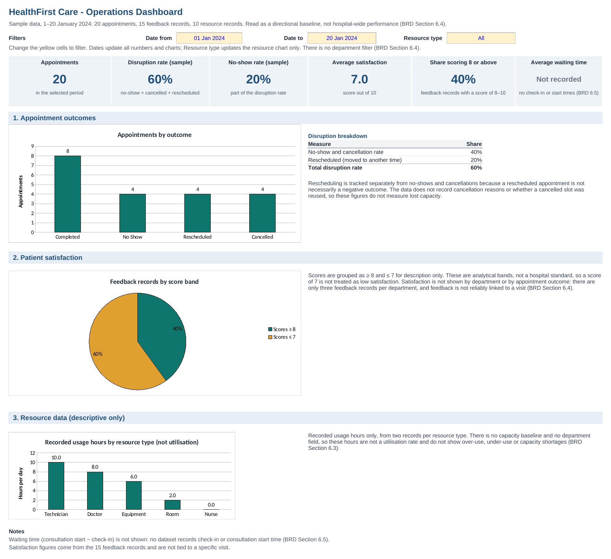

# Data Analysis

*HealthFirst Care - Cleaned data, baseline indicators, analysis tables and the dashboard*

[← Process Analysis](05-process-analysis.md) · [README](../README.md) · [Risk Management Plan →](07-risk-management-plan.md)

---

The Data Analysis Workbook (Excel) cleans and links the three source datasets, then produces the figures reported in [BRD Section 6](02-brd.md#6-data-analysis-summary) and in the [Project Summary](00-project-summary.md). Every summary figure is a formula. Change the cleaned data and the figures follow. This page shows the results. The source datasets are in [`data/`](../data).

> **Sample data, 1–20 January 2024:** 20 appointments, 15 feedback records, 10 resource records. Read as a directional baseline, not hospital-wide performance (BRD Section 6.4).

## Dashboard

*Dashboard sheet of the workbook. It filters by date and resource type; there is no department filter (BRD Section 6.4).*

## Workbook structure

| Sheet | Content |
|---|---|
| KPI Summary | Headline metrics, calculated from the cleaned data. |
| Cleaned_Appointment | 20 appointment records prepared for analysis. |
| Cleaned_Feedback | 15 feedback records prepared for analysis. |
| Cleaned_Resource | 10 resource records prepared for analysis. |
| Analysis | Appointment volume by time slot, an exploratory feedback–appointment match, and feedback comments on waiting. |
| Dashboard | KPI cards, appointment outcomes (no-shows and cancellations vs rescheduled appointments), satisfaction score bands and recorded resource usage hours (descriptive), filtered by date and resource type. |
| Dashboard_Data | Supporting formulas behind the Dashboard KPI cards and charts (kept on a separate sheet so the Dashboard shows only results). |

## Key figures

*All figures below are formulas referencing the Cleaned_ sheets.*

### 1. Appointment Volume & Disruption

| Metric | Value | Source / formula basis |
|---|---|---|
| Total appointments analysed | 20 | COUNTA of AppointmentID |
| Completed | 8 | COUNTIF Status = Completed |
| No Show | 4 | COUNTIF Status = No Show |
| Rescheduled | 4 | COUNTIF Status = Rescheduled |
| Cancelled | 4 | COUNTIF Status = Cancelled |
| Appointment disruption rate (sample) | 60% | (No Show + Rescheduled + Cancelled) / Total |
| No-show rate (sample) | 20% | No Show / Total |

### 2. Patient Satisfaction

| Metric | Value | Source / formula basis |
|---|---|---|
| Feedback records analysed | 15 | COUNT of SatisfactionScore (Cleaned_Feedback) |
| Average satisfaction score | 7.0 / 10 | AVERAGE of SatisfactionScore (Cleaned_Feedback) |
| Feedback records with scores ≥ 8 | 6 | COUNTIF SatisfactionScore ≥ 8 (Cleaned_Feedback) |
| Feedback records with scores ≤ 7 | 9 | COUNTIF SatisfactionScore ≤ 7 (Cleaned_Feedback) |
| Share of records scoring ≥ 8 | 40% | Scores ≥ 8 / all scored records |

Note (exploratory match only): 9 of the 15 feedback records share PatientID and date with appointments recorded as No Show, Cancelled or Rescheduled (Analysis, Section 2).
Satisfaction is calculated from Cleaned_Feedback only and is not tied to a specific visit (BRD Section 6.4).

### 3. Resource Data Summary (Descriptive)

| Metric | Value | Source / formula basis |
|---|---|---|
| Recorded usage — Technician (hrs/day) | 10 | AVERAGEIF ResourceType = Technician |
| Recorded usage — Doctor (hrs/day) | 8 | AVERAGEIF ResourceType = Doctor |
| Recorded usage — Equipment (hrs/day) | 6 | AVERAGEIF ResourceType = Equipment |
| Recorded usage — Room (hrs/day) | 2 | AVERAGEIF ResourceType = Room |
| Recorded usage — Nurse (hrs/day) | 0 | AVERAGEIF ResourceType = Nurse |

Note: Nurse usage of 0 hrs/day reflects both nurse records being flagged 'Unavailable', not spare capacity.
Two records per resource type, with no capacity baseline or department attribution: these are recorded hours, not a utilisation rate (BRD Section 6.3).

### 4. Disruption breakdown

| Metric | Value | Source / formula basis |
|---|---|---|
| No-show and cancellation rate (sample) | 40% | Recorded as No Show or Cancelled; slot reuse is not recorded |
| Rescheduled rate (sample) | 20% | Appointment moved to another time — still inside the 60% headline |

Why the split matters: the 60% headline mixes appointments recorded as No Show or Cancelled with appointments that were only moved to another time.
A rescheduled appointment is not necessarily a negative outcome, so the two are tracked separately. Slot reuse is not recorded, so neither figure measures lost capacity.
The dataset does not record who initiated a cancellation (see BRD Section 6.4).

## Analysis tables

*Three summary tables, plus a helper table (Section 4) that supports the Section 2 match. Every figure is a formula reading the Cleaned_ sheets, not a pasted number. Recorded resource usage by type is in the KPI Summary sheet.*

### 1. Appointment count by time slot

| Time | Count of AppointmentID |
|---|---|
| 10:00 | 4 |
| 11:00 | 4 |
| 14:00 | 4 |
| 15:00 | 4 |
| 16:00 | 4 |
| Grand Total | 20 |

Appointments are evenly distributed across the recorded time slots. Each slot belongs to one department, doctor and outcome, so slot differences reflect the constructed data.
The data cannot establish actual peak-hour demand and cannot confirm or rule out the peak-time shortages reported by staff.

### 2. Exploratory match: feedback vs appointments not held as scheduled

| Measure | Count |
|---|---|
| Feedback records | 15 |
| No Show match (same PatientID + date) | 3 |
| Cancelled match (same PatientID + date) | 3 |
| Rescheduled match (same PatientID + date) | 3 |
| Feedback records matched to No Show, Cancelled or Rescheduled appointments (counted once) | 9 |

Exploratory match only: feedback has no AppointmentID, so a shared PatientID and date does not confirm that the feedback refers to that visit.
Satisfaction is not compared between departments: there are only three feedback records per department, and feedback is not reliably linked to a visit (BRD Section 6.4).

### 3. Feedback comments mentioning waiting or delay

| Metric | Count |
|---|---|
| Comments mentioning wait or delay | 2 |
| Total comments | 15 |

Only 2 of 15 comments mention waiting or delay (FeedbackID 2 shares PatientID and date with a No Show appointment), and none mentions notifications.
Patient profiles report waits of more than 30 minutes, but no dataset records check-in or consultation start time, so waiting time cannot be baselined (BRD Section 6.5).

4. Helper: exploratory match per feedback record (supports Section 2)

Each feedback record is checked for an appointment with the same PatientID and date. This is not a confirmed link to a visit.

| FeedbackID | Matched status |
|---|---|
| 1 | Completed |
| 2 | No Show |
| 3 | Rescheduled |
| 4 | Cancelled |
| 5 | Completed |
| 6 | Completed |
| 7 | No Show |
| 8 | Rescheduled |
| 9 | Cancelled |
| 10 | Completed |
| 11 | Completed |
| 12 | No Show |
| 13 | Rescheduled |
| 14 | Cancelled |
| 15 | Completed |

## Key analytical decisions

| Item | Note |
|---|---|
| Satisfaction bands | Scores are grouped as ≥ 8 and ≤ 7 for description only. These are analytical bands, not a hospital standard; a score of 7 is not treated as low satisfaction. |
| Missing feedback | Appointments without a feedback record are excluded from satisfaction analysis rather than imputed. |

## KPI definitions

| Item | Note |
|---|---|
| Appointment disruption rate (sample) | (No Show + Cancelled + Rescheduled) / Total. Descriptive only: a rescheduled appointment is not necessarily a negative outcome. |
| No-show and cancellation rate (sample) | (No Show + Cancelled) / Total. Descriptive only: the data does not show whether cancelled slots were reused, so this is not a measure of lost capacity. |
| No-show rate (sample) | No Show / Total. |
| Patient waiting time | Consultation start time − Check-in time (proposed definition, BRD FR-16; to be confirmed with Hospital Management). Not measurable from the current data. |

## Data limitations

| Item | Note |
|---|---|
| Feedback linkage | feedback_data has no AppointmentID; feedback cannot be reliably tied to individual visits. |
| Sample size | 20 appointment records: suitable for descriptive analysis only, not a hospital-wide rate. Cancellation and rescheduling reasons are not recorded. Validate against operational data before setting targets. |

## Data preparation and quality notes

| Item | Note |
|---|---|
| Date and time format | Source CSV dates use DD-MM-YY (e.g., 13-01-24 = 13 January 2024) and times are text (e.g., '2:00 PM'). The Cleaned_ sheets hold them as date and time values; no other values were changed. |
| Repeating outcome pattern | Each department has one doctor, one time slot and the same outcome across all four of its appointments (e.g., all Cardiology appointments are Completed; all Orthopedics appointments are No Show). Department-level rates reflect the constructed data, not real performance. |
| Resource status vs usage | R4 and R9 (Room) are 'Under Maintenance' but show 2 usage hours, and the Doctor records are 'Available' with 8 usage hours. The data does not say whether status and usage cover the same period; values are kept as recorded. |
| Comment vs score | Some comments do not match their score (e.g., FeedbackID 15: 'Very good' with a score of 6). Comments and scores are kept as recorded. |
| Wait-related feedback | FeedbackID 2 ('Long wait times') shares PatientID and date with an appointment recorded as No Show, so it is weak evidence of waiting time. |

The full list of limitations and measurement gaps is in [BRD Section 6.4](02-brd.md#64-data-limitations) and [6.5](02-brd.md#65-measurement-gaps-and-open-questions).

---

[← Process Analysis](05-process-analysis.md) · [README](../README.md) · [Risk Management Plan →](07-risk-management-plan.md)
